<h1 align="center">Victor Basilio</h1>

  <b>Desenvolvedor Full Stack</b> · TypeScript, React, Node.js e Python 
  Construo sistemas para pequenos negócios e cuido deles em produção depois da entrega.

  
  
  

  João Pessoa, PB · Ciência da Computação na UNIPÊ (conclusão em jul/2027) · aberto a estágio e vagas júnior

---

## Sobre mim

Sou estudante de Ciência da Computação no 7º período e desenvolvedor freelancer. Atendo pequenos negócios de João Pessoa do levantamento de requisitos ao deploy, e continuo dando suporte e evoluindo os sistemas depois que eles entram em uso.

Uso IA no dia a dia, mas com uma regra fixa: não entrego código que eu não entenda linha por linha. Tudo passa por testes, revisão e decisões de arquitetura documentadas.

## Projetos em destaque

<table>
<tr>
<td width="50%" valign="top">

#### Crediário `em produção`
**PWA de vendas parceladas para varejo**

Substituiu a planilha e o caderno de um lojista que vende no crediário para cerca de 700 clientes. Cadastro de clientes e vendas, rotas de cobrança por dia do mês e financeiro, funcionando mesmo sem internet.

- Offline-first, instalável no celular (Workbox)
- Firestore multi-tenant, isolado por negócio
- Pagamentos append-only em centavos inteiros e status das parcelas calculado na leitura
- Infra de custo zero: Firebase Spark + Vercel

`React` `TypeScript` `Firebase` `Vite` `Workbox` `Tailwind`

</td>
<td width="50%" valign="top">

#### Vassouras Pernambucanas `no ar`
**Catálogo B2B para uma fábrica de produtos de limpeza**

Canal para a fábrica vender a outras empresas, que antes recebiam o catálogo e faziam pedidos só pelo WhatsApp.

- Front em React e API em Django REST Framework
- Deploy no Railway com variáveis de ambiente e reference variables
- Catálogo em duas etapas, com imagens por categoria

`React` `Django` `DRF` `Python` `Railway`

</td>
</tr>
<tr>
<td width="50%" valign="top">

#### Catálogo com ERP legado
**Integração com Firebird 2.5.9**

Catálogo B2C de uma loja de João Pessoa alimentado pelo ERP que a loja já usa no caixa.

- Sincronização incremental pelo contador `SINCRONISMO` do ERP
- Do ERP vêm só nome, preços e estoque; categorias, descrições e fotos ficam no banco do site e nunca são sobrescritas pela sincronização

`Python` `Firebird` `SQL`

</td>
<td width="50%" valign="top">

#### GraphRAG / KAG
**Perguntas e respostas sobre história da computação**

Trabalho em equipe da faculdade combinando grafo de conhecimento e busca vetorial. Fiquei com a recuperação e a avaliação: busca vetorial, Text-to-Cypher, travessia multi-hop e grounding com procedência.

- Base de ~30 artigos da Wikipédia em português, embeddings multilíngues de 384 dimensões
- [Conjunto de avaliação publicado no Hugging Face](https://huggingface.co/datasets/VictorbSilva/graphrag-kag-historia-computacao-avaliacao)

`Python` `Neo4j` `LLMs` `Hugging Face`

</td>
</tr>
</table>

| Outros projetos | O que faz | Stack |
|---|---|---|
| **FluxoDocente** | Plataforma de cursos que capacita docentes do ensino superior no uso de IA (meu TCC). Autenticação, progresso por usuário, módulos liberados por desempenho e certificado. | TypeScript · Node.js · Express · Render |
| **Finance App** (Lab05) | Sistema de finanças em microsserviços, feito por uma squad de 20 pessoas com dailies e GitHub Flow. Atuei no serviço de autenticação e usuários e montei a documentação da API com OpenAPI. | Node.js · Express · TypeScript · MongoDB · Swagger |
| **[Grupo Economia do Mar](https://grupoeconomiadomar.com)** | Site do grupo de pesquisa, meu primeiro projeto voluntário em equipe. No ar desde dez/2025. | React · FastAPI |
| **[gondor-livraria](https://github.com/mentoria-mithril/gondor-livraria)** | Projeto em equipe da Mentoria Mithril, organizado por issues e pull requests. | TypeScript · Next.js · Express |

## Stack do dia a dia

**Linguagens** 

**Front-end** 

**Back-end** 

**Dados** 

**Testes, deploy e ferramentas** 

## Como eu trabalho

| Testes primeiro | Decisões registradas | IA com controle |
|---|---|---|
| TDD com Jest: escrevo o teste antes do código e uso AAA, test doubles e testes parametrizados. | Arquitetura definida e documentada antes de começar. Regra de negócio não se inventa: toda dúvida é validada com o cliente. | Agentes com documentação de escopo e armadilhas do projeto, hooks que bloqueiam push direto na `main`, revisão minha em toda tarefa e validação cruzada com um segundo modelo. |

## GitHub

  
  

Boa parte do meu trabalho de freelancer fica em repositórios privados dos clientes. Posso apresentar a arquitetura e o código em uma conversa técnica.

---

  <b>Tem uma vaga de estágio ou júnior, ou um projeto para tirar do papel?</b> 
  <a href="mailto:victorbasilio5@gmail.com">Vamos conversar.</a>

